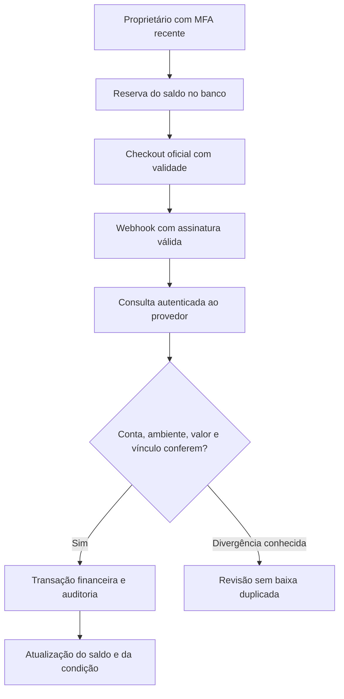

# Cobrança e pagamentos — v0.4

## Resultado implementado

A Central de Cobranças reúne parcelas abertas, saldo, faixa de atraso, promessas informadas, condições de entrada/entrega e histórico de contatos. As condições começam como proposta. Somente uma data real e uma referência de aceite as tornam condições aceitas no sistema.

Quando uma condição aceita exigir entrada, a transição do projeto para execução exige o valor registrado. Quando exigir quitação, a conclusão do projeto exige o pagamento integral. A regra existe no domínio e em um trigger do banco. Ela não suspende sites, perfis, anúncios ou outros serviços externos de clientes.

Mensagens são rascunhos revisáveis. Copiar não envia nem registra contato como realizado. Vencimento e validade do checkout têm datas reais. Não há urgência inventada, juros ou multas automáticos, protesto, negativação ou promessa de resultado jurídico. Uma exceção comercial deve ser decidida e registrada pelo proprietário, preservando a trilha da condição anterior.

## Integração inicial

Mercado Pago Checkout Pro por preferências é o primeiro adaptador implementado. É uma decisão técnica inicial, sujeita à escolha do proprietário e à elegibilidade/configuração da conta. Stripe e assinaturas não foram implementados nesta versão.

O checkout é hospedado no provedor. A Central informa referência, valor da parcela e validade e recebe a URL do checkout. Não envia um cadastro completo do cliente para montar o link. A confirmação consulta o pagamento no provedor, sem confiar em valores e estados enviados pelo navegador ou no corpo do webhook.

A integração permanece desativada por padrão. Nenhuma credencial real foi configurada, nenhum link real foi gerado e nenhuma cobrança foi enviada nesta entrega.

## Caminho de uma cobrança

O retorno público `/pagamento/retorno` não dá baixa financeira. Os parâmetros dessa página nunca são usados como prova de pagamento.

## Integridade financeira

- Valores são centavos inteiros. A criação usa o saldo atual do banco, com trava do contrato, sem aceitar um valor arbitrário do navegador.
- Uma chave de criação repetida não dispara outra criação no provedor. Como a API de preferências não é tratada como uma operação com idempotência garantida pelo provedor, um resultado incerto exige conferência; não há retry cego de criação.
- Uma parcela pode receber um novo link para saldo residual após um pagamento/devolução. Links anteriores não são usados no rascunho quando já foram utilizados, expiraram ou não correspondem ao saldo vigente.
- Cada pagamento é único por provedor, ID e ambiente. Eventos antigos não desfazem uma confirmação mais recente.
- Assinatura HMAC é verificada com comparação constante. Após a verificação, a API confirma recebedor, moeda, ambiente, referência, valor e data. A assinatura identifica o recurso; o estado financeiro vem da consulta autenticada.
- Retransmissões antigas com assinatura válida podem ser consultadas novamente. A defesa contra duplicação está também no ID persistido e na transação, preservando tentativas legítimas do provedor.
- Operações da mesma conta sem referência conhecida da Central são ignoradas. O sistema não importa indiscriminadamente todas as movimentações da conta do recebedor.
- Pagamento com valor divergente, saldo já baixado manualmente, contrato encerrado ou contestação conhecida fica em revisão. Ele não gera uma segunda baixa. O botão **Conferir agora** consulta novamente um pagamento já vinculado à operação, com MFA recente.
- Recebimento do provedor não pode ser estornado manualmente pelo navegador. Devoluções aprovadas são lidas do provedor e viram eventos próprios, preservando o original e reabrindo o saldo correspondente.
- A aplicação não possui comando de solicitar devolução no provedor. Faça essa operação diretamente no provedor, seguindo seu procedimento; a Central apenas concilia o resultado verificado.
- Uma contestação/chargeback exige conferência. Não inventamos a data ou o valor de uma saída bancária a partir de um simples aviso.

O saldo gerencial usa recebimentos brutos, despesas e devoluções registradas. Não é saldo bancário nem disponibilidade de saque do provedor. Taxas informadas pelo provedor são metadados para conciliação, não despesas automaticamente liquidadas.

## Separação de teste e dinheiro real

Pagamentos em `test` são registros de simulação. Não criam recebimento real, não quitam parcela e não alteram o caixa. Rascunhos de cobrança não incluem link sandbox para envio a clientes. Ainda assim, use projeto de homologação separado e exemplos fictícios.

O modo `live` exige ambiente da aplicação em produção, confirmação explícita por variável, configuração correspondente no banco e conta/credenciais conferidas. O roteiro inicial SQL habilita somente teste. Não transforme um projeto de testes em produção trocando flags e mantendo seus dados.

## Conta técnica restrita

O recebimento de webhooks não depende de William estar conectado. O servidor usa o papel PostgreSQL `pomar_billing_worker` pelo pooler, com TLS e verificação de certificado. Esse papel não recebe acesso às tabelas da operação nem herda papéis de usuário. Suas permissões da aplicação ficam limitadas a consultar a configuração técnica mínima, confirmar uma preferência, registrar falha de criação e conciliar pagamentos verificados.

As funções privilegiadas usam `search_path` vazio, conferem `session_user`, conta, ambiente e proprietário fixado no banco. O servidor confere a configuração do worker antes de pedir um checkout ao provedor. Não usa `service_role`, chave `sb_secret_...` ou senha de administrador do banco.

## Configuração manual

1. Conclua `CONFIGURACAO.md` e as três migrações em um projeto novo de homologação. A aplicação funciona sem ativar a integração.
2. Crie/configure a aplicação de pagamentos na conta escolhida do Mercado Pago e confirme o uso de testes, os meios disponíveis e os requisitos da conta. Tarifas e habilitações devem ser conferidas na própria conta.
3. Configure Webhooks para eventos de pagamento, com HTTPS, apontando para `ORIGEM/api/webhooks/mercadopago`. Use Webhooks, não IPN.
4. Guarde Access Token e segredo do webhook no ambiente privado do servidor. Nunca em variáveis `NEXT_PUBLIC_`, Git, mensagens ou capturas.
5. Prepare um segredo exclusivo de conexão do worker no seu gerenciador. Execute `supabase/03_cobranca_configuracao.sql` em sessão privada do SQL Editor, preenchendo o UUID do proprietário, o ID da conta recebedora de teste e esse segredo. Não salve/compartilhe a cópia preenchida.
6. No diálogo Connect do Supabase, copie o host real do pooler do projeto. A URI precisa usar `pomar_billing_worker.PROJECT_REF`, porta 6543 ou 5432 e banco `postgres`. Codifique corretamente caracteres especiais da senha na URI. Não use o usuário `postgres`.
7. Se a cadeia de certificados exigir o CA do projeto, obtenha-o pelo painel oficial e preencha `POMAR_BILLING_DB_CA_BASE64`. A conexão nunca usa `rejectUnauthorized=false`.
8. Preencha as variáveis abaixo no servidor, reinicie e confira o estado na Central de Cobranças. Só então faça testes com compradores e meios de teste oficiais.

| Variável                       | Finalidade                                                      |
| ------------------------------ | --------------------------------------------------------------- |
| `POMAR_BILLING_ENABLED`        | `false` por padrão; `true` somente com a configuração concluída |
| `POMAR_PAYMENT_MODE`           | `test` em homologação                                           |
| `POMAR_MP_ACCESS_TOKEN`        | Token privado da aplicação/conta de teste correta               |
| `POMAR_MP_WEBHOOK_SECRET`      | Segredo de assinatura do endpoint                               |
| `POMAR_MP_COLLECTOR_ID`        | ID exato da conta recebedora                                    |
| `POMAR_BILLING_DATABASE_URL`   | Conexão do papel restrito, no mesmo projeto do Supabase         |
| `POMAR_BILLING_DB_CA_BASE64`   | CA do projeto quando necessário                                 |
| `POMAR_BILLING_LIVE_CONFIRMED` | Vazio em teste; produção exige `yes` depois da homologação      |

## Aceite antes de ativar produção

Conferir no serviço real: login e TOTP; bloqueio por inatividade; valores e validade do link; meios habilitados na conta; HMAC; entrega/repetição de notificações; pagamento aprovado; pagamento recusado; divergência; conciliação; devolução parcial e total; confirmação atrasada após cancelamento; falha de rede durante criação; permissões reais do worker; TLS; logs e alerta de falha; restauração de banco e recuperação das contas.

Os testes locais exercitam funções reais do PostgreSQL com representação controlada do Auth e respostas simuladas do provedor. Não substituem esse aceite. Também não provam ausência de vulnerabilidades nem funcionamento da integração no ambiente que ainda será criado manualmente.

## Operação e interrupção

- Se uma criação ficar incerta, confira o provedor e o registro da Central antes de tentar outra. Não invente uma URL nem marque como pago pelo retorno do checkout.
- Se houver divergência, revise valor, vínculo e lançamentos manuais. Use **Conferir agora** após a correção pertinente; a conciliação permanece idempotente.
- Para interromper a integração, desative a variável e a configuração privada do banco, bloqueie o login do worker e revogue/rotacione as credenciais comprometidas. Links já emitidos precisam ser tratados também no provedor; desativar a Central não é cancelar um checkout remoto.
- Mantenha monitoramento de respostas 4xx/5xx dos webhooks, retenção adequada e alertas no ambiente de hospedagem antes do uso real.

## Referências oficiais consultadas

- [Mercado Pago: criar preferência](https://www.mercadopago.com.br/developers/pt/reference/online-payments/checkout-pro-preferences/create-preference/post)
- [Mercado Pago: vigência da preferência](https://www.mercadopago.com.br/developers/pt/docs/checkout-pro-preferences/additional-settings/term-of-preference)
- [Mercado Pago: Webhooks](https://www.mercadopago.com.br/developers/en/docs/checkout-pro-preferences/additional-settings/optional-notifications)
- [Supabase: conexão por papel próprio no pooler](https://supabase.com/docs/guides/database/connecting-to-postgres)
- [Supabase: claims JWT](https://supabase.com/docs/guides/auth/jwt-fields)
